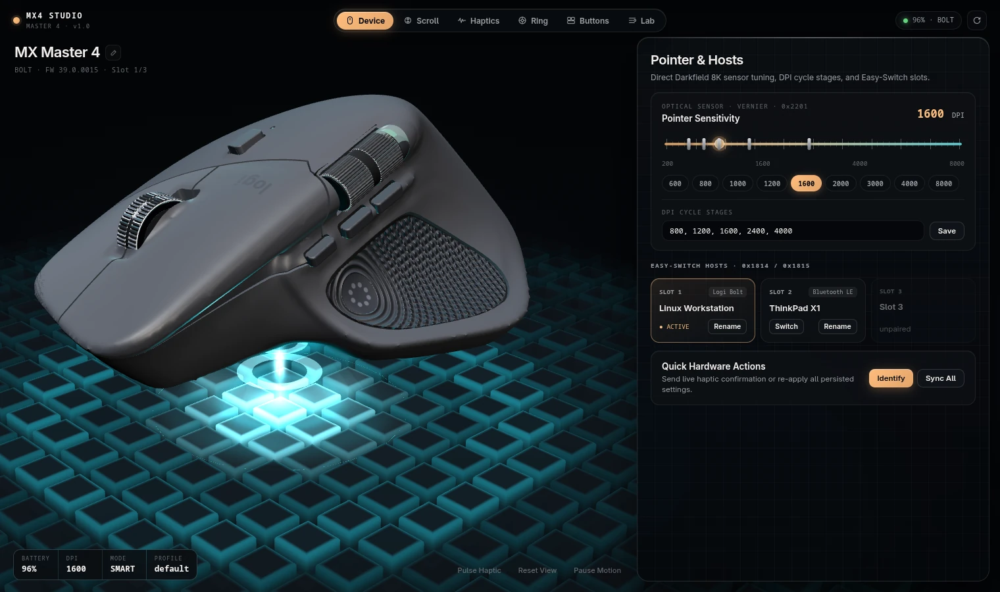
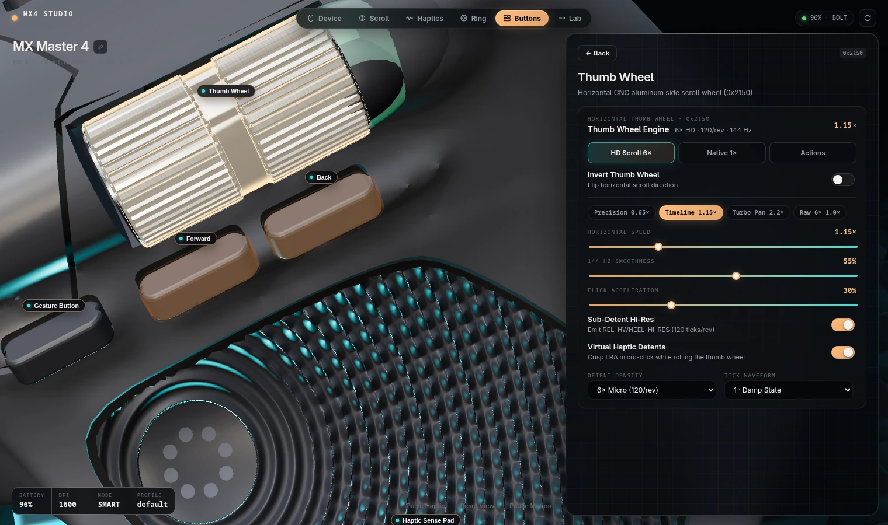
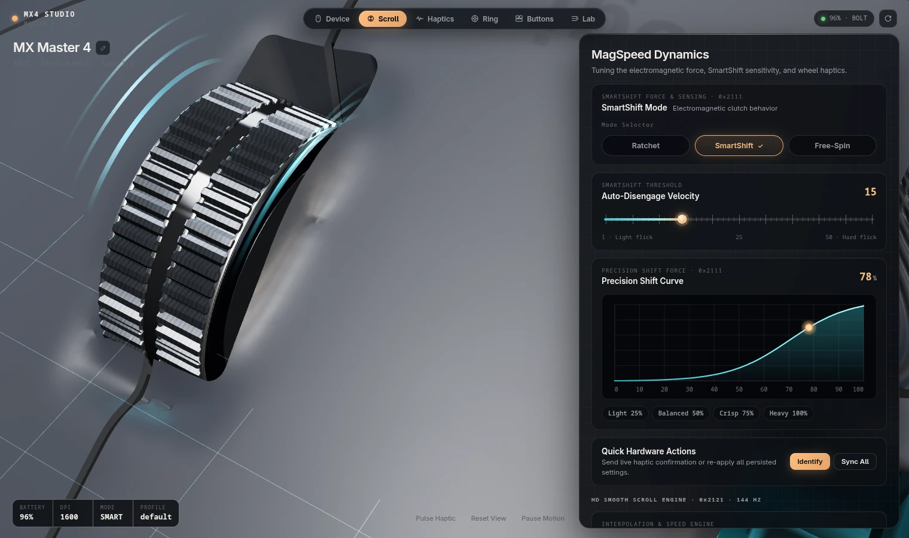
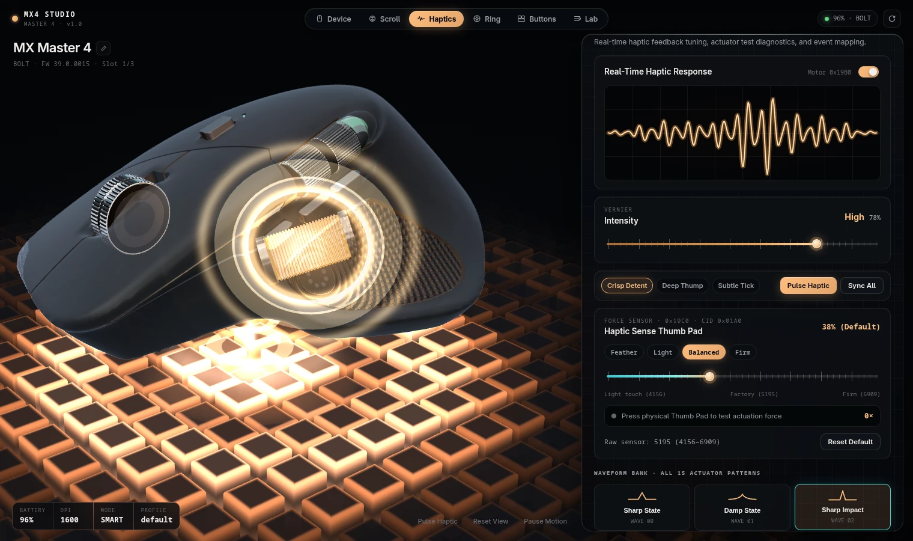
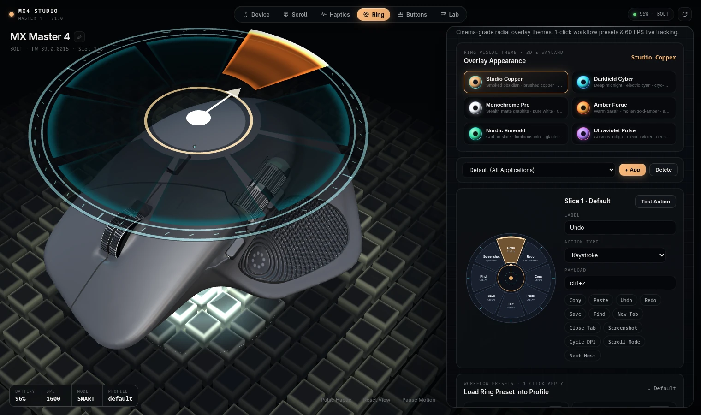

<div align="center">

# M X 4 &nbsp; S T U D I O

### Precision Linux &amp; Wayland Control for the Logitech MX Master 4

<sub><code>3D WEBGL2 CAD STUDIO</code> &nbsp;·&nbsp; <code>NATIVE HID++ 2.0 DAEMON</code> &nbsp;·&nbsp; <code>6× HD THUMB WHEEL</code> &nbsp;·&nbsp; <code>60 FPS ACTIONS RING</code> &nbsp;·&nbsp; <code>15-WAVEFORM LRA HAPTICS</code></sub>

<br />

[](https://github.com/timmy16744/mx4control)
[](https://github.com/timmy16744/mx4control)
[](LICENSE)
[](https://www.paypal.com/qrcodes/p2pqrc/T4X8KXBNDDALL)

<br />



<sub><b>Live 3D Hardware Studio</b> — Darkfield 8000 DPI Vernier · 625-cube optical pulse floor · Real-time 60 Hz physical click, wheel &amp; glide telemetry · Easy-Switch hosts</sub>

</div>

<br />

**MX4 Studio (`mx4control`)** unlocks every hardware subsystem of the **Logitech MX Master 4** natively on Linux — no Wine, no Logi Options+, no compromise. Built on a split systemd/D-Bus architecture (`mx4-sysd` + `mx4-agent`) with a hardware-accelerated 3D WebGL2 interface, every adjustment writes directly over HID++ 2.0 and reflects in real time.

---

## Visual Tour

<table>
  <tr>
    <td width="50%" align="center">
      
      <br />
      <strong>6× HD Thumb Wheel &amp; Macro Inspector</strong> <code>0x2150</code>
      <br />
      <sub>Unlocks diverted <b>120 ticks/rev</b> (6× native detail), 144 Hz smooth <code>REL_HWHEEL_HI_RES</code>, 6× virtual LRA micro-detents, and Digital Crown actions.</sub>
    </td>
    <td width="50%" align="center">
      
      <br />
      <strong>MagSpeed Dynamics &amp; 144 Hz Scroll</strong> <code>0x2111 · 0x2121</code>
      <br />
      <sub>SmartShift, Ratchet &amp; Free-Spin modes, tunable hardware ratchet torque S-curve (1–100%), and critically-damped smooth scroll with velocity boost.</sub>
    </td>
  </tr>
  <tr>
    <td width="50%" align="center">
      
      <br />
      <strong>15-Waveform LRA Haptics &amp; Force Pad</strong> <code>0x19B0 · 0x19C0</code>
      <br />
      <sub>Live copper X-ray LRA cutaway, 60 FPS waveform oscilloscope, all 15 built-in actuator patterns, tunable thumb-pad force (<code>4156–6909</code>), and notification haptics.</sub>
    </td>
    <td width="50%" align="center">
      
      <br />
      <strong>60 FPS Wayland Actions Ring</strong> <code>0x1B04</code>
      <br />
      <sub>6 curated themes, 8 one-click workflow presets, magnetic analog compass tracking, per-app auto-switching, and native <code>gtk4-layer-shell</code> rendering.</sub>
    </td>
  </tr>
</table>

---

## Flagship Capabilities

| Subsystem | HID++ 2.0 | What It Unlocks |
|---|---|---|
| **Darkfield 8000 DPI &amp; Live 3D Telemetry** | `0x2201` | 200–8000 DPI in 50-DPI hardware steps, custom DPI cycle stages, and 60 Hz physical glide, click, wheel &amp; rear status light-pipe mirroring on an interactive 3D MX Master 4 CAD model. |
| **MagSpeed Scroll &amp; 144 Hz HD Engine** | `0x2111` · `0x2121` | SmartShift (threshold 1–50), Ratchet, Free-Spin, **hardware tunable ratchet torque (1–100%)**, interactive S-curve tuning, and 144 Hz hi-res smooth scrolling. |
| **6× High-Detail Thumb Wheel Engine** | `0x2150` | Unlocks diverted **`120 ticks/rev`** (6× finer than native `20 ticks/rev`) with 1 ms hardware timestamps, 144 Hz `REL_HWHEEL_HI_RES`, **6× virtual LRA micro-detents**, live horizontal test ruler, and 12 Digital Crown action presets (1–120 tick step resolution + micro-tick texture). |
| **LRA Haptic Motor &amp; Force Thumb Pad** | `0x19B0` · `0x19C0` | Master motor switch, 1–100% strength, all **15 hardware waveforms** with live oscilloscope, tunable thumb-pad actuation force (`4156–6909`), and desktop notification haptics. |
| **60 FPS Wayland Actions Ring** | `0x1B04` + `gtk4-layer-shell` | **6 visual themes** (*Studio Copper, Darkfield Cyber, Monochrome Pro, Amber Forge, Nordic Emerald, Ultraviolet Pulse*), **8 workflow presets** (*Hyprland WM, PipeWire Media, Code/IDE, MX4 Hardware Deck*, and more), live compass tracking, and per-app auto-switching. |
| **Click-to-Zoom Inspector &amp; Hold-Key PTT** | `0x1B04` | Click any button, wheel, or pad on the 3D mouse to zoom straight into its settings — bind shortcuts, shell commands, hardware actions, firmware remaps, per-app overrides, or kernel evdev **Hold-Key Push-to-Talk** (`key_hold`). |
| **Easy-Switch Hosts &amp; Hardware Lab** | `0x1814` · `0x1815` · `0x0007` | Live Bolt/BLE slot telemetry, one-click host switching, firmware host/device renaming, instant wake re-sync (`0x1D4B`), and a live 45-feature HID++ 2.0 feature probe. |

---

## Architecture

```text
mx4-sysd (root, systemd) ── HID++ 2.0 ──► Logitech MX Master 4 (Bolt / BLE)
   │  System D-Bus: org.mx4control.System  (/etc/mx4control/device.toml)
   ├── 144 Hz Hi-Res uinput Engines (Vertical 0x2121 + 6× Horizontal 0x2150)
   ├── mx4-settings   Native QtWebEngine + WebGL2 3D MX4 Studio
   ├── mx4ctl         Scriptable CLI & JSON telemetry (Waybar / AGS / scripts)
   └── mx4-agent      User session daemon (org.mx4control.Agent)
                        ├── 60 FPS Wayland Actions Ring (gtk4-layer-shell + Cairo)
                        ├── Zero-latency Hyprland / Sway / X11 focus watcher
                        ├── Diverted button, Hold-Key PTT & Digital Crown dispatchers
                        └── Desktop notification haptic watcher
```

## Prerequisites

Install the system packages for your distribution (Python 3.12+, Qt6 WebEngine / PySide6, GTK4 Layer Shell, HID++ &amp; evdev bindings):

- **Arch Linux:** `sudo pacman -S python-pyside6 qt6-webengine gtk4-layer-shell python-gobject python-cairo python-hidapi python-evdev python-pyudev python-tomlkit wtype`
- **Fedora:** `sudo dnf install python3-pyside6 qt6-qtwebengine gtk4-layer-shell python3-gobject python3-cairo python3-hidapi python3-evdev python3-pyudev python3-tomlkit wtype`
- **Ubuntu / Debian:** `sudo apt install python3-pyside6.qtwebenginewidgets libgtk4-layer-shell0 python3-gi python3-cairo python3-hid python3-evdev python3-pyudev python3-tomlkit wtype`

## Quick Install

```bash
git clone https://github.com/timmy16744/mx4control.git
cd mx4control
sudo ./install.sh
sudo systemctl enable --now mx4-sysd.service
systemctl --user enable --now mx4-agent.service
```

Launch **MX4 Studio** from your application launcher or run:

```bash
mx4-settings
```

## CLI Quick Reference (`mx4ctl`)

```bash
mx4ctl state                                                # live hardware & agent snapshot
mx4ctl dpi 1600                                             # set sensor DPI (200–8000)
mx4ctl scroll-mode smart --threshold 20 --torque 75         # MagSpeed mode & ratchet torque
mx4ctl thumbwheel hd_scroll --speed 1.15 --smooth 55 --haptic --density 6
mx4ctl haptic-power on --level 75                           # enable LRA motor (0x19B0)
mx4ctl haptic 2                                             # fire hardware waveform 0–14
mx4ctl force default                                        # reset thumb-pad actuation force
mx4ctl hosts                                                # list Easy-Switch slots
mx4ctl host 1                                               # switch active host slot
mx4ctl probe                                                # probe all 45 HID++ 2.0 features
```

## Development &amp; Tests

```bash
PYTHONPATH=src pytest -q
ruff check src/ tests/
```

---

<div align="center">

### Support MX4 Studio

If MX4 Studio saved you time or unlocked your mouse on Linux, you can **[buy my 1 year old son nappies to say thanks](https://www.paypal.com/qrcodes/p2pqrc/T4X8KXBNDDALL)**.

<sub>MIT License — see <a href="LICENSE">LICENSE</a></sub>

</div>
